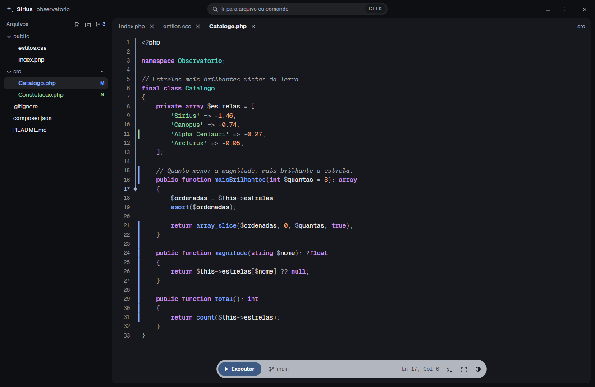
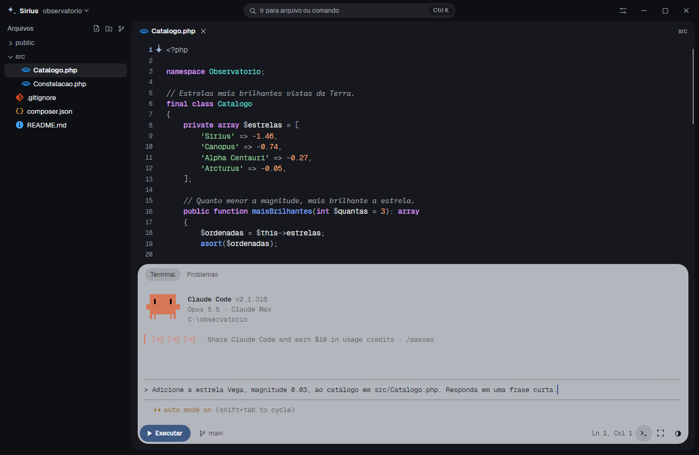
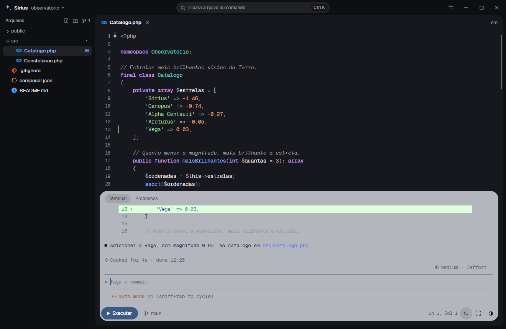
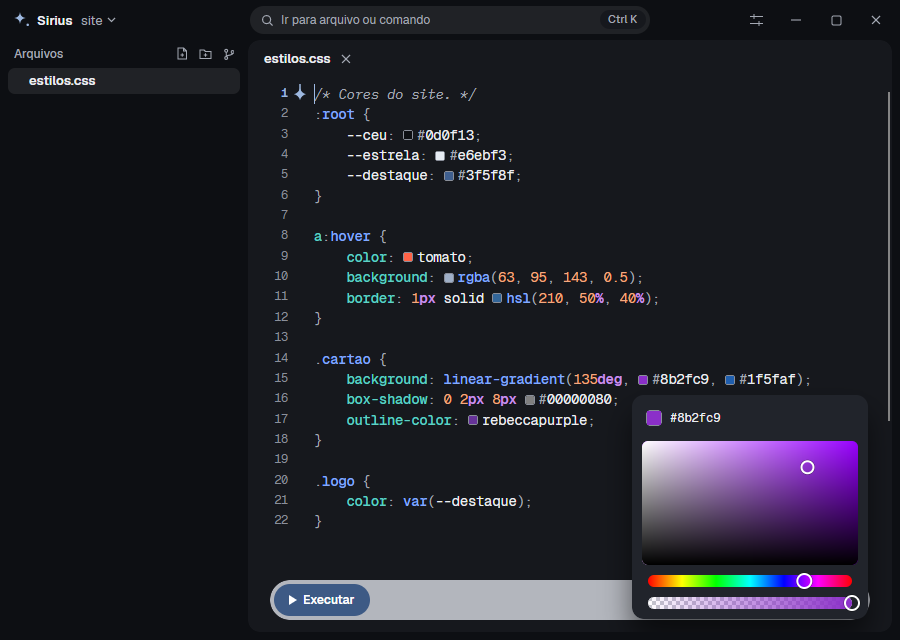
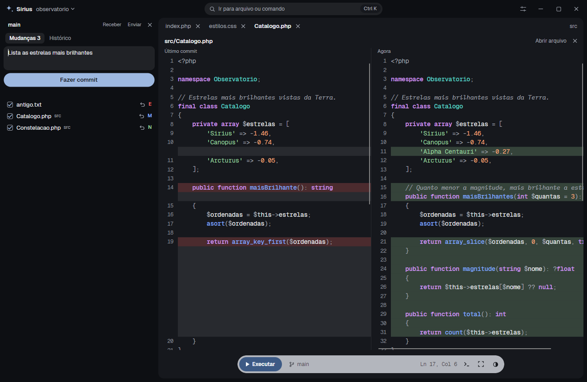
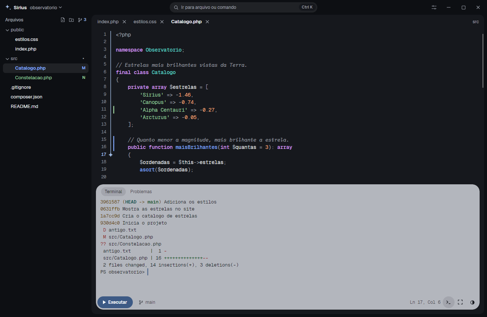
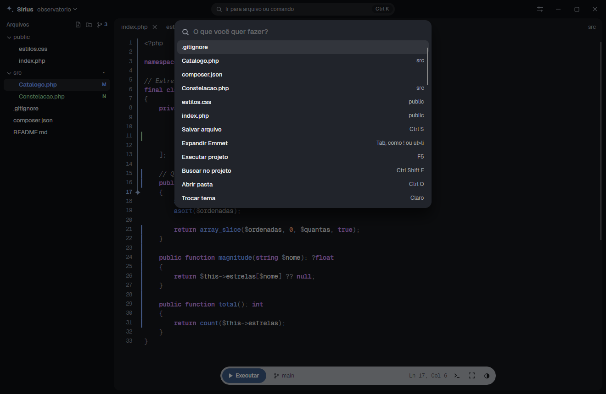
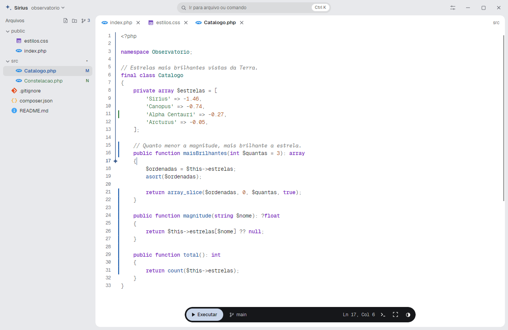

<div align="center">

# 🌟 Sirius

IDE **nativa** para Windows, simples e direta, sem WebView nem Electron. Editor, terminal, Git e inteligência de código no mesmo lugar, numa interface que sai da frente do seu código.



<br><br>

[](https://github.com/erickfuzer/Sirius/releases/latest)
[](https://erickfuzer.github.io/Sirius/)

</div>

> [!NOTE]
> A Sirius ainda está em desenvolvimento: funciona no dia a dia, mas espere arestas. Faça commit do seu trabalho e relate o que encontrar em [Issues](https://github.com/erickfuzer/Sirius/issues).

## Funcionalidades

- **Editor:** abas, sintaxe colorida para dezenas de linguagens, zoom, temas claro e grafite, modo foco e quebra de linha. Aspas, parênteses, chaves e tags de HTML se fecham enquanto você digita
- **Edição do dia a dia:** comentar linhas, duplicar e mover linhas, ir para uma linha e formatar o arquivo inteiro, pelo teclado, pela barra de comando ou pelo botão direito do mouse no editor
- **Cores do CSS:** um quadradinho mostra cada cor no código, e clicar nele abre um seletor que altera o texto na hora. Funciona em CSS, SCSS, Sass e Less, e dentro de `<style>` e `style="..."` em HTML e PHP
- **Emmet:** em HTML e PHP, `div.cartao>h2+p` vira o HTML pronto, e `!` cria a página inicial. Como no VS Code, a abreviação aparece na lista de sugestões com a prévia do HTML: <kbd>Enter</kbd> ou <kbd>Tab</kbd> expande, e "Expandir Emmet" no botão direito também. O <kbd>Tab</kbd> seguinte pula para o próximo campo vazio, e isso funciona sem instalar nada
- **Imagens:** PNG, JPG, GIF, WebP, BMP e ICO abrem em uma aba, com zoom, arrastar, xadrez atrás da transparência e a foto na posição certa. O SVG abre como código, para poder editar, com o desenho ao lado acompanhando a digitação. A prévia nunca busca nada fora do arquivo
- **Abrir de fora:** arraste arquivos ou pastas do Explorer para a janela, ou clique com o botão direito neles e use "Abrir com Sirius". Isso vale para código, texto, imagens e pastas. Com a Sirius já aberta, o arquivo vira uma aba da mesma janela, mesmo vários de uma vez, e a pasta abre uma janela nova
- **Barra de comando:** <kbd>Ctrl</kbd> + <kbd>K</kbd> encontra arquivos e executa ações sem tirar a mão do teclado
- **Projeto:** árvore de arquivos para criar, renomear e excluir, com busca e substituição em todo o projeto
- **Terminal integrado:** a cápsula flutuante se abre em um terminal completo. O botão Executar detecta o comando do projeto, e os erros da saída são clicáveis. Em PHP, ele sobe o servidor e oferece abrir o site no navegador, ou o arquivo em uso em pastas sem `index.php`. Se o computador não tiver PHP, oferece a instalação
- **Depuração de PHP:** clique na margem para marcar uma linha, execute e abra a página. A Sirius para ali e mostra o valor de cada variável, inclusive `$_POST` e `$_GET`, também ao parar o mouse sobre ela, além do que a página já escreveu. Você avança linha por linha, entra nas funções e vê a pilha de chamadas: clicar em quem chamou leva àquela linha e mostra as variáveis de lá. O Xdebug é baixado na primeira vez, se você aceitar, sem mudar a sua instalação do PHP
- **Inteligência de código:** autocompletar, erros no código, ir para a definição, encontrar todos os usos, dicas e renomear símbolo. Se faltar o suporte a uma linguagem, a própria IDE oferece a instalação
- **Git:** mudanças na árvore e na margem, comparação lado a lado, commit por arquivo, descartar, enviar, receber, branches e histórico de commits, com o que mudou em cada um. Se o computador não tiver Git, oferece a instalação
- **Sessão:** cada pasta reabre as suas abas, e a IDE acompanha o que outros programas mudam no disco. As pastas recentes ficam na tela inicial e no nome da pasta, no topo da janela
- **Preferências:** tema, tamanho da letra, recuo (2 ou 4 espaços, ou Tab), fechar aspas e tags, quebra de linha e aviso de versão nova, pelo botão de ajustes ao lado de minimizar, no topo da janela. Cada escolha vale na hora
- **Atualizar pela própria IDE:** um aviso discreto na cápsula anuncia a versão nova. Em "Atualizar agora", a Sirius baixa o instalador da página de Releases, confere que ele é exatamente o arquivo que o GitHub registrou, fecha, instala por cima e abre de novo. Nada é baixado sem o seu clique, e o aviso pode ser desligado nas preferências
- **Cuidado com o seu trabalho:** salvar mantém a codificação original do arquivo e passa por um arquivo temporário, criar nunca sobrescreve e excluir vai para a Lixeira
- **Pronta para ABNT2:** o <kbd>AltGr</kbd> nunca aciona um atalho, então `?` e `/` funcionam normalmente

### Com o Claude Code no terminal

O terminal da Sirius é um terminal completo, então o [Claude Code](https://claude.com/claude-code) roda dentro dela, com cores, rolagem pela roda do mouse e acentos. Você pede na cápsula, com o projeto aberto logo acima:



Ele edita o arquivo, e a mudança aparece na hora no editor e nas marcas do Git:



<details>
<summary>Ver as cores do CSS</summary>
<br>

</details>

<details>
<summary>Ver o painel de Git</summary>
<br>

</details>

<details>
<summary>Ver o terminal</summary>
<br>

</details>

<details>
<summary>Ver a barra de comando</summary>
<br>

</details>

<details>
<summary>Ver o tema claro</summary>
<br>

</details>

## Como funciona

A interface é desenhada pelo [Avalonia](https://avaloniaui.net), sem navegador embutido, e o editor usa o [AvaloniaEdit](https://github.com/AvaloniaUI/AvaloniaEdit) com gramáticas TextMate para a sintaxe.

O terminal roda no ConPTY, o mesmo mecanismo de terminal do próprio Windows. A inteligência de código conversa com servidores de linguagem pelo protocolo LSP: quando falta o servidor de um arquivo aberto, a cápsula oferece a instalação para C#, PHP, HTML, CSS, JavaScript, TypeScript e Python. Go, Rust e C++ funcionam se `gopls`, `rust-analyzer` ou `clangd` estiverem instalados. O Git é o seu próprio `git`, sem biblioteca no meio.

A depuração de PHP usa o [Xdebug](https://xdebug.org): a Sirius baixa o arquivo certo para o seu PHP, confere o código dele com uma lista fixa no programa e o liga só durante a execução, sem alterar o `php.ini`. A conversa com o Xdebug fica dentro do computador.

A única consulta que a Sirius faz por conta própria é perguntar à API pública do GitHub qual é a última versão, ao abrir e ao voltar para a janela, no máximo uma vez por hora. Ela não envia nada do seu projeto e pode ser desligada em "Aviso de versão nova", nas preferências. O instalador só é baixado quando você clica em "Atualizar agora".

## Como usar

**Instalador:** baixe o `Setup.exe` em [Releases](https://github.com/erickfuzer/Sirius/releases/latest) e abra. Ele instala só para o seu usuário, sem pedir administrador, e já leva o .NET junto. Requer Windows 10 versão 1809 ou mais recente, em 64 bits.

> O instalador ainda não tem assinatura digital, então o Windows pode mostrar um aviso azul. Clique em **Mais informações** e depois em **Executar assim mesmo**.

**Pelo código:** com o [SDK do .NET 10](https://dotnet.microsoft.com/download):

```bash
git clone https://github.com/erickfuzer/Sirius.git
cd Sirius
dotnet run --project src/Sirius
```

Para gerar o instalador, instale também o [Inno Setup 6](https://jrsoftware.org/isinfo.php) e rode o script abaixo. O arquivo sai em `artifacts\installer`.

```powershell
.\installer\build.ps1
```

### Atalhos

| Atalho | Ação |
|---|---|
| <kbd>Ctrl</kbd> <kbd>K</kbd> | Barra de comando: encontrar arquivos e executar ações |
| <kbd>Ctrl</kbd> <kbd>O</kbd> | Abrir pasta |
| <kbd>Ctrl</kbd> <kbd>N</kbd> | Nova aba sem nome |
| <kbd>Ctrl</kbd> <kbd>S</kbd> | Salvar |
| <kbd>Ctrl</kbd> <kbd>Shift</kbd> <kbd>S</kbd> | Salvar como |
| <kbd>Ctrl</kbd> <kbd>W</kbd> | Fechar aba |
| <kbd>Ctrl</kbd> <kbd>F</kbd> | Procurar no arquivo |
| <kbd>Ctrl</kbd> <kbd>Shift</kbd> <kbd>F</kbd> | Buscar em todo o projeto (<kbd>Enter</kbd> avança pelos resultados) |
| <kbd>Ctrl</kbd> <kbd>.</kbd> | Modo foco |
| <kbd>Ctrl</kbd> <kbd>,</kbd> | Preferências |
| <kbd>F5</kbd> | Executar ou parar o projeto. Parado em uma linha marcada, continuar |
| <kbd>F10</kbd> | Parado em uma linha marcada, ir para a próxima |
| <kbd>F11</kbd> e <kbd>Shift</kbd> <kbd>F11</kbd> | Parado em uma linha marcada, entrar na função e sair dela |
| Clique à esquerda do número da linha | Em PHP, marcar onde a depuração para |
| <kbd>Ctrl</kbd> <kbd>J</kbd> | Abrir ou fechar o terminal |
| <kbd>Ctrl</kbd> <kbd>Shift</kbd> <kbd>G</kbd> | Painel de Git: mudanças, histórico, comparação, commit, enviar e receber |
| <kbd>Ctrl</kbd> <kbd>+</kbd> e <kbd>Ctrl</kbd> <kbd>-</kbd> | Aumentar ou diminuir a fonte do editor (<kbd>Ctrl</kbd> <kbd>0</kbd> volta ao padrão). Em uma imagem, aproximar e afastar |
| <kbd>Ctrl</kbd> + roda do mouse | Mudar a fonte do editor ou o zoom da imagem |
| Dois cliques na imagem | Alternar entre o tamanho real e caber na área |
| Arrastar para a janela | Pasta vira o projeto aberto, arquivo abre em uma aba |
| <kbd>F2</kbd> | Renomear o item da lista de arquivos ou, no editor, o símbolo sob o cursor |
| <kbd>F12</kbd> ou <kbd>Ctrl</kbd> + clique | Ir para a definição |
| <kbd>Shift</kbd> <kbd>F12</kbd> | Encontrar todos os usos do nome sob o cursor, no painel da busca |
| <kbd>Ctrl</kbd> <kbd>Espaço</kbd> | Mostrar sugestões |
| <kbd>Ctrl</kbd> <kbd>/</kbd> | Comentar ou descomentar as linhas. No ABNT2, também <kbd>Ctrl</kbd> <kbd>;</kbd> |
| <kbd>Alt</kbd> <kbd>↑</kbd> e <kbd>Alt</kbd> <kbd>↓</kbd> | Mover as linhas para cima ou para baixo |
| <kbd>Shift</kbd> <kbd>Alt</kbd> <kbd>↓</kbd> | Duplicar as linhas |
| <kbd>Shift</kbd> <kbd>Alt</kbd> <kbd>F</kbd> | Formatar o arquivo |
| <kbd>Ctrl</kbd> <kbd>G</kbd> ou clique em "Ln" na cápsula | Ir para uma linha |
| <kbd>Alt</kbd> <kbd>Z</kbd> | Ligar ou desligar a quebra de linha |
| <kbd>Tab</kbd> | Em HTML e PHP, expandir uma abreviação do Emmet e pular entre os campos vazios. Sem a tecla, use "Expandir Emmet" no botão direito |

### Para desenvolver

- **Testes:** `dotnet test Sirius.slnx`. Usam xUnit e rodam a janela de verdade, sem abrir nada na tela.
- **Preferências:** ficam em `%APPDATA%\Sirius\settings.json`.

## Limitações

- Só funciona no Windows: o terminal, o instalador e a integração com o Explorer são específicos dele.
- A depuração é só de PHP e começa pelo botão Executar.
- Conflitos de Git são resolvidos editando o arquivo.
- Entre os programas de tela cheia no terminal, o Claude Code foi testado, mas o `vim` não. O terminal repassa a roda do mouse a eles, mas não os cliques.
- GIF animado mostra só o primeiro quadro. Na prévia do SVG, imagens e fontes de outros endereços não aparecem, de propósito.
- O instalador ainda não tem assinatura digital. A atualização confere o arquivo com o registro do GitHub, mas isso confia na conta do GitHub do projeto, como o download manual.

## Estrutura

```
Sirius/
├── src/Sirius/
│   ├── MainWindow.*        # janela, abas, árvore, busca, terminal, linguagem e Git
│   ├── Core/               # lógica sem interface: arquivos, busca, Git e preferências
│   ├── Editing/            # documento aberto, sintaxe, margem com o fio e aba de imagem
│   ├── Lsp/                # conexão com os servidores de linguagem
│   ├── Terminal/           # ConPTY, interpretador de sequências e tela do terminal
│   ├── Theming/            # temas claro e grafite
│   └── Assets/             # ícone e fontes
├── tests/Sirius.Tests/     # testes da lógica e da janela
├── installer/              # script do instalador (Inno Setup), build.ps1 e notas das versões
├── docs/                   # site (GitHub Pages), prints do README e prévia de link
├── LICENSE
└── README.md
```

## Créditos

Interface feita com [Avalonia](https://avaloniaui.net) e [AvaloniaEdit](https://github.com/AvaloniaUI/AvaloniaEdit), com sintaxe pelo [TextMateSharp](https://github.com/danipen/TextMateSharp) e prévia de SVG pelo [Svg.Skia](https://github.com/wieslawsoltes/Svg.Skia), todos sob a licença MIT, que usa também o [SVG.NET](https://github.com/svg-net/SVG), sob a licença MS-PL. As fontes [Geist](https://vercel.com/font) e [IBM Plex Mono](https://www.ibm.com/plex/) são distribuídas sob a licença SIL Open Font, com os textos em `src/Sirius/Assets/Fonts`. Desenvolvido com o auxílio do [Claude](https://claude.ai) (Anthropic).

## Licença

[MIT](LICENSE): use, modifique e distribua à vontade.

<div align="center">
<sub>Feito por <a href="https://github.com/erickfuzer">Erick Fuzer</a></sub>
</div>
